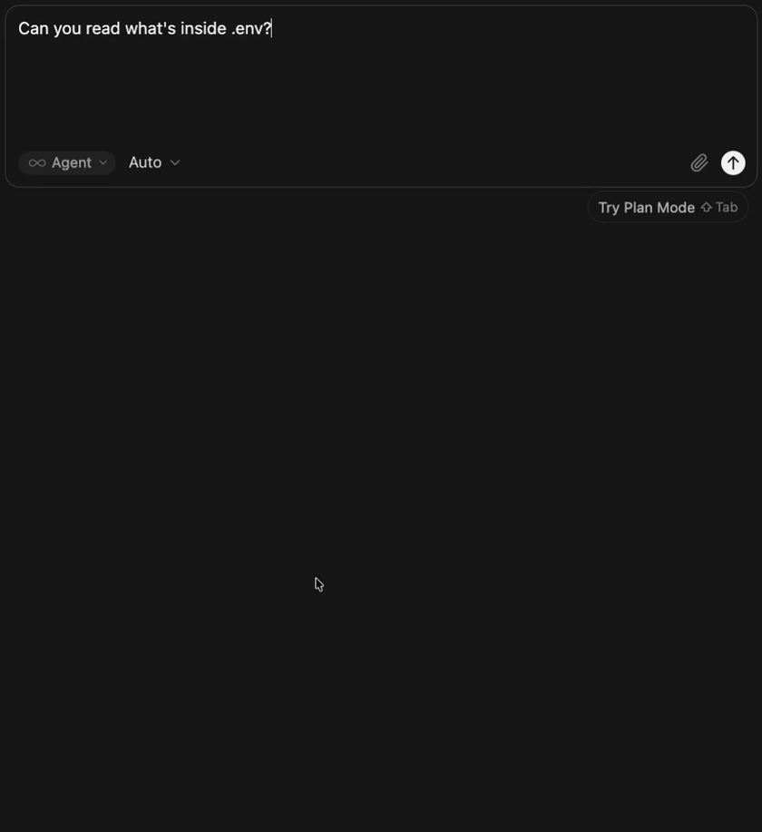

# RuleCloud

Guardrails for AI-speed engineering: **Cloud Rulespacks**, a **CLI watch HUD**, **GitHub PR scans**, and an **MCP server** for Cursor and other agents.

| Component | URL |
|-----------|-----|
| Console | https://rulecloud.vercel.app |
| API | https://rulecloud-production.up.railway.app |
| MCP Registry | `io.github.lemonbanan4/rulecloud` @ [MCP Registry](https://registry.modelcontextprotocol.io) |
| npm CLI | [`rulecloud`](https://www.npmjs.com/package/rulecloud) |

**Repo:** https://github.com/lemonbanan4/rulecloud (public)

## Quick start (CLI)

```bash
export RULECLOUD_API_KEY=rc_live_...   # from console → API Keys
npx rulecloud init                     # writes .guardrail/rules.yml + Cursor MCP
rulecloud sync-hooks                   # Claude + Cursor hooks tied to rules.yml
npx rulecloud watch                    # live violations HUD
```

**Hook parity (CI):** `.github/workflows/guardrail.yml` fails PRs when `.claude/settings.json` or `.cursor/hooks.json` drift from `.guardrail/rules.yml`. After editing rules, run `rulecloud sync-hooks` and commit the updated hook files.

**Claude Code fail-closed:** `sync-hooks` writes `onFailure: "block"` on PreToolUse hooks (v2.1.295+). If the guard script is missing or crashes, Claude **does not** run the tool. Cursor uses `failClosed: true` on the same guard.

## Local API (Python backend)

Use the project **venv** — macOS `pip` on system Python 3.9 is often broken (`pip._internal.operations.build` missing).

```bash
python3 -m venv venv
source venv/bin/activate
pip install -r requirements.txt
cp .env.example .env               # NVIDIA_API_KEY, Supabase, etc.
uvicorn main:app --reload --port 8000
```

## MCP (Cursor, Claude Code, VS Code)

Streamable HTTP — **do not open `/mcp/` in a browser** (you will see a JSON-RPC “text/event-stream” message; that is normal). Use this setup page or configure your IDE:

- **Setup (browser):** https://rulecloud-production.up.railway.app/api/mcp  
- **MCP endpoint:** `https://rulecloud-production.up.railway.app/mcp/` (trailing slash required)

Create `rc_live_…` at https://rulecloud.vercel.app/dashboard/keys, then add to `.cursor/mcp.json`:

```json
{
  "mcpServers": {
    "rulecloud": {
      "url": "https://rulecloud-production.up.railway.app/mcp/",
      "headers": {
        "X-API-Key": "rc_live_YOUR_KEY"
      }
    }
  }
}
```

**Tools:** `scan_code`, `get_default_rules`, `generate_guardrail_rules`, `suggest_fix` (Pro).

## Monorepo layout

| Path | Stack | Deploy |
|------|--------|--------|
| `/` | FastAPI + guardrail CLI + MCP | Railway (`Dockerfile`) |
| `/web` | Next.js console | Vercel (`web/`) |
| `/cli` | `rulecloud` npm package | npm |

**Env**
- Vercel: `NEXT_PUBLIC_API_URL` → Railway API URL (`web/.env.example`)
- Railway: `FRONTEND_URL` → Vercel URL (CORS), `LLM_*` for AI Copilot

## Demo repo

https://github.com/lemonbanan4/rulecloud-demo

## Health check

```bash
curl -sS https://rulecloud-production.up.railway.app/health
```
